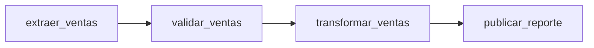

# Ejemplo de ventas con Apache Airflow

Proyecto académico que utiliza **Apache Airflow 3.3.2** y su interfaz pública `airflow.sdk` para procesar ventas. Incluye código, datos de muestra, pruebas y un [reporte en español](docs/reporte.md).

## Qué hace

Lee `data/ventas.csv`, valida sus registros, calcula las unidades y los ingresos por producto y publica `resumen.json` y `ventas_por_producto.csv` en `output/ejecucion_<hash>/`.



El lote de ejemplo contiene 10 ventas de café, chocolate y té. El resultado esperado es **21 unidades y $2,105.00 MXN**. Cada ejecución procesa todo el archivo; la fecha del CSV no se filtra según el día de ejecución.

## Abrir la interfaz de Airflow

Necesitas Docker Desktop iniciado y Docker Compose. Los comandos se ejecutan desde la carpeta del proyecto. La primera ejecución descarga la imagen oficial y puede tardar varios minutos.

```bash
git clone https://github.com/Yvess7/Airflow.git
cd Airflow
docker compose up -d --wait
```

Si ya tienes abierta la carpeta `Airflow`, ejecuta solamente el último comando.

Abre **http://localhost:8080**. El usuario es **`alumno`**. Consulta la contraseña que Airflow genera localmente:

```bash
docker compose exec airflow cat /opt/airflow/runtime/passwords.json
```

El comando muestra un objeto JSON. Usa como contraseña el valor asociado a `alumno`.

En Linux, antes del primer arranque, crea `.env` con `AIRFLOW_UID` igual al resultado de `id -u`, para que el contenedor pueda escribir en `output/`. En macOS puedes usar los valores predeterminados. Si el puerto 8080 está ocupado, crea `.env` con `AIRFLOW_PORT=8081` y abre http://localhost:8081.

## Ejecutar y revisar el ejemplo

1. En la interfaz, busca el DAG **`ventas_diarias`**. Puede tardar alrededor de un minuto en aparecer.
2. Activa el DAG y pulsa **Trigger** o el botón de ejecución.
3. Abre la ejecución y su vista de gráfico. Las cuatro tareas deben terminar en estado **success**, en verde.
4. Abre los logs de `publicar_reporte` para ver el resumen y las rutas de salida.
5. Revisa la nueva carpeta dentro de `output/` en tu computadora.

| Producto | Unidades | Ingresos en MXN |
| --- | ---: | ---: |
| Café | 8 | 960.00 |
| Chocolate | 7 | 665.00 |
| Té | 6 | 480.00 |
| **Total** | **21** | **2105.00** |

El DAG también tiene programación diaria en UTC. Al activarlo puede aparecer una ejecución automática además de la manual. Cada ejecución conserva su propia carpeta.

Para dispararlo desde una terminal, después de activar el DAG:

```bash
docker compose exec airflow airflow dags trigger ventas_diarias
docker compose exec airflow airflow dags list-runs ventas_diarias
```

Para detener el servicio conservando sus datos:

```bash
docker compose down
```

## Probar el código

### Lógica de ventas sin instalar Airflow

Con Python 3.10 o superior, sin dependencias adicionales:

```bash
python3 -m unittest discover -s tests -v
python3 scripts/ejecutar_local.py
python3 scripts/verificar_salida.py
```

El primer comando ejecuta ocho pruebas; el segundo crea archivos en `output/`; el tercero compara las salidas con el resultado esperado. Esta opción prueba las funciones de ventas; no ejecuta el motor de Airflow.

### Las cuatro tareas reales dentro de Airflow

Esta prueba utiliza `dag.test()` con una base de metadatos temporal, separada de la interfaz. Puede ejecutarse aunque la interfaz esté detenida:

```bash
docker compose run --rm --no-deps \
  -v ./scripts:/opt/airflow/scripts:ro \
  -v ./evidencias:/opt/airflow/evidencias:ro \
  airflow bash /opt/airflow/scripts/probar_dag.sh
```

Debe terminar con `state=success` y el mensaje `Resultados verificados`. La prueba también compara los archivos JSON y CSV con los valores esperados.

### Probar una entrada incorrecta

Cambia temporalmente una cantidad del CSV por `0`, ejecuta el DAG y revisa el error de `validar_ventas` en sus logs. Hay dos reintentos de un minuto antes del fallo definitivo. Las tareas siguientes no deben publicar resultados para esa ejecución. Restaura el valor original antes de la siguiente demostración.

## Archivos principales

| Archivo | Contenido |
| --- | --- |
| [docs/reporte.md](docs/reporte.md) | Reporte con explicación, ejemplo, resultados y referencias |
| [dags/ventas_diarias.py](dags/ventas_diarias.py) | DAG con cuatro tareas TaskFlow |
| [dags/ventas/etl.py](dags/ventas/etl.py) | Reglas de validación, cálculos y escritura |
| [data/ventas.csv](data/ventas.csv) | Ventas ficticias utilizadas en la demostración |
| [compose.yaml](compose.yaml) | Entorno local con la imagen oficial y almacenamiento persistente |
| [tests/test_etl.py](tests/test_etl.py) | Pruebas de cálculos, datos inválidos y reintentos |
| [evidencias](evidencias/) | Resultado esperado y evidencia de una ejecución real |
| [.github/workflows/pruebas.yml](.github/workflows/pruebas.yml) | Pruebas automáticas para GitHub Actions |

`requirements.txt` fija la versión para una instalación alternativa con Python. Docker ya incluye Airflow; no necesitas instalar ese archivo para utilizar los comandos anteriores.

## Si algo no abre

Comprueba que Docker Desktop esté iniciado y ejecuta:

```bash
docker compose ps
docker compose logs --tail 80 airflow
```

Si no aparece el DAG, revisa los errores de importación:

```bash
docker compose exec airflow airflow dags list-import-errors
```

El entorno usa `standalone` y SQLite para aprendizaje local. Para lotes grandes se requiere almacenamiento compartido de datos y pasar referencias a archivos entre tareas, en lugar de filas completas mediante XCom.

Basado en la [interfaz pública de Apache Airflow](https://airflow.apache.org/docs/apache-airflow/stable/public-airflow-interface.html).
