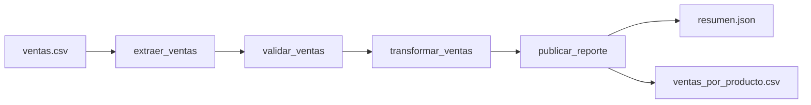

# Reporte de procesamiento de ventas con Apache Airflow

**Autor:** Yvess7  
**Fecha:** 9 de noviembre de 2026  
**Repositorio:** https://github.com/Yvess7/Airflow  
**Entorno:** Apache Airflow 3.3.2 con Python 3.12 y Docker

## Introducción

Una tienda necesita convertir sus registros de ventas en un resumen por producto. Hacerlo manualmente exige revisar los datos, calcular importes y preparar archivos cada vez que llega un nuevo lote. Este proyecto organiza esas actividades en un flujo de Apache Airflow que permite observar qué tarea se ejecuta y en qué punto ocurre un error.

El ejemplo procesa un archivo ficticio de diez ventas y genera un CSV por producto y un resumen JSON. El resultado comprobado es de **21 unidades vendidas y $2,105.00 MXN**.

## Objetivo

Implementar y probar un flujo de extracción, transformación y carga de datos de ventas mediante la interfaz pública de Airflow. La demostración permite identificar dependencias entre tareas, revisar errores de calidad de datos, configurar reintentos y consultar los resultados de una ejecución.

## Conceptos utilizados

Airflow representa el flujo mediante un DAG, un grafo dirigido sin ciclos. Sus tareas tienen dependencias: una actividad que necesita datos de otra debe esperar a que ésta finalice correctamente. En este proyecto el flujo es lineal, por lo que una venta inválida impide que se publique el resumen del lote.

Para definir el DAG se utilizan `dag`, `task` y `get_current_context` desde `airflow.sdk`. Esta elección sigue la interfaz pública para autores de DAG de Airflow 3. El código de las tareas no consulta directamente la base de metadatos de Airflow. [Referencia de la interfaz pública](https://airflow.apache.org/docs/apache-airflow/stable/public-airflow-interface.html).

TaskFlow permite declarar tareas como funciones de Python. Cuando el resultado de una función se entrega a otra tarea, Airflow establece la dependencia y transporta el valor mediante XCom. En este ejemplo se intercambian listas pequeñas y un diccionario de resumen. [Tutorial de TaskFlow](https://airflow.apache.org/docs/apache-airflow/3.3.2/tutorial/taskflow.html).

## Datos y alcance del ejemplo

El archivo [ventas.csv](../data/ventas.csv) contiene ventas ficticias del 1 de noviembre de 2026. Los precios se expresan en pesos mexicanos. Cada registro representa una venta de un producto, que puede contener varias unidades.

| Campo | Significado | Ejemplo |
| --- | --- | --- |
| `venta_id` | Identificador único dentro del lote | `V001` |
| `fecha` | Fecha de la venta en formato AAAA-MM-DD | `2026-11-01` |
| `producto` | Nombre del producto | `Café` |
| `cantidad` | Número entero positivo de unidades | `2` |
| `precio_unitario` | Precio positivo con hasta dos decimales | `120.00` |

Cada ejecución lee el archivo completo. Aunque el DAG tiene una programación diaria, el ejemplo no selecciona ventas por la fecha de ejecución. Es una demostración de procesamiento de un lote fijo, sin impuestos, descuentos ni devoluciones.

## Diseño e implementación

El DAG se llama `ventas_diarias` y está definido en [ventas_diarias.py](../dags/ventas_diarias.py). Las funciones de negocio se encuentran en [etl.py](../dags/ventas/etl.py).



| Tarea | Trabajo realizado | Salida |
| --- | --- | --- |
| `extraer_ventas` | Comprueba la cabecera y lee el CSV UTF-8 | Lista de registros |
| `validar_ventas` | Rechaza campos vacíos, fechas inválidas, identificadores duplicados, cantidades y precios incorrectos | Registros con tipos normalizados |
| `transformar_ventas` | Agrupa por producto y calcula unidades e ingresos | Diccionario de resumen |
| `publicar_reporte` | Guarda archivos y registra sus rutas en los logs | CSV y JSON |

La definición utiliza este import público:

```python
from airflow.sdk import dag, get_current_context, task
```

Las dependencias se declaran pasando el resultado de una tarea a la siguiente:

```python
publicar_reporte(transformar_ventas(validar_ventas(extraer_ventas())))
```

El DAG configura `schedule="@daily"`, una fecha de inicio fija en UTC, `catchup=False` y `max_active_runs=1`. Así se programa diariamente, se evita crear todas las ejecuciones históricas desde la fecha inicial y se limita a una ejecución activa. Cada tarea dispone de dos reintentos separados por un minuto.

Para calcular dinero se convierte el precio a centavos enteros. Por ejemplo, tres unidades de $0.10 producen exactamente 30 centavos. Los importes se presentan como cadenas con dos decimales para conservar su representación en JSON y CSV.

La tarea de publicación usa el identificador de ejecución obtenido del contexto. Calcula su hash SHA-256 para crear una carpeta segura y diferente por ejecución. Si la misma tarea se reintenta, reemplaza sus archivos en esa carpeta. Cada archivo se escribe primero en un temporal y después se reemplaza; esto evita dejar un archivo individual a medio escribir. El reemplazo de ambos archivos no constituye una transacción conjunta.

## Cómo reproducir la demostración

Con Docker Desktop iniciado, desde la carpeta del proyecto:

```bash
docker compose up -d --wait
docker compose exec airflow cat /opt/airflow/runtime/passwords.json
```

Abre http://localhost:8080 e inicia sesión con el usuario `alumno` y la contraseña generada que muestra el segundo comando. Busca `ventas_diarias`, actívalo y dispara una ejecución. En el gráfico deben observarse las cuatro tareas en verde. Los resultados quedan disponibles en la carpeta `output/` del proyecto.

La configuración utiliza la imagen oficial `apache/airflow:3.3.2-python3.12`. El comando `airflow standalone` reúne los componentes necesarios para una demostración local. El volumen de Docker conserva la base de metadatos y los logs entre reinicios. Este modo corresponde a desarrollo y aprendizaje. [Guía de inicio de Airflow](https://airflow.apache.org/docs/apache-airflow/3.3.2/start.html).

El [README](../README.md) incluye instrucciones para detener el servicio, cambiar el puerto y consultar errores de importación.

## Pruebas y resultados

Se ejecutaron ocho pruebas automatizadas con `unittest`. Comprueban el resultado completo del lote, los importes decimales, la detección de registros inválidos, los duplicados, los lotes vacíos, la cabecera, las columnas incompletas o adicionales y la publicación repetida de una misma ejecución.

```bash
python3 -m unittest discover -s tests -v
```

También se ejecutaron las cuatro tareas reales con `dag.test()` dentro de la imagen oficial de Airflow 3.3.2. Este método crea una ejecución del DAG usando una base de metadatos inicializada y permite verificar el flujo sin iniciar una interfaz web. [Documentación de pruebas de DAG](https://airflow.apache.org/docs/apache-airflow/3.3.2/core-concepts/debug.html).

La ejecución terminó en `state=success`. La comparación del CSV y del JSON generados con el resultado esperado fue satisfactoria. Se conserva evidencia en la carpeta [evidencias](../evidencias/); `resumen_esperado.json` es el valor de referencia, mientras que `resumen_obtenido.json` y `ventas_por_producto_obtenido.csv` corresponden a la ejecución real.

También se comprobó el inicio de sesión en la instancia local y se disparó la ejecución `demostracion_reporte` mediante el servicio activo. El DAG y sus cuatro tareas finalizaron en `success`; el servicio quedó disponible en http://localhost:8080. Los estados se conservan en [estados_interfaz.txt](../evidencias/estados_interfaz.txt).

| Producto | Unidades | Cálculo de ingresos | Ingresos en MXN |
| --- | ---: | --- | ---: |
| Café | 8 | 8 × 120.00 | 960.00 |
| Chocolate | 7 | 7 × 95.00 | 665.00 |
| Té | 6 | 6 × 80.00 | 480.00 |
| **Total** | **21** | **960.00 + 665.00 + 480.00** | **2105.00** |

El total de diez ventas es el número de registros del archivo; las veintiuna unidades corresponden a la suma de sus cantidades. Ambos indicadores describen medidas distintas.

Para repetir la prueba de Airflow con una base temporal aislada:

```bash
docker compose run --rm --no-deps \
  -v ./scripts:/opt/airflow/scripts:ro \
  -v ./evidencias:/opt/airflow/evidencias:ro \
  airflow bash /opt/airflow/scripts/probar_dag.sh
```

El repositorio incluye un flujo de GitHub Actions que repite las pruebas de la lógica de ventas y la ejecución del DAG en cada push o pull request.

## Limitaciones y mejoras

El uso de XCom para transportar filas es adecuado para los diez registros de la demostración. Para archivos grandes, las tareas deberían intercambiar rutas a objetos en almacenamiento compartido y procesar los datos con herramientas apropiadas al volumen.

Los archivos se leen y escriben en volúmenes locales del mismo entorno. Una instalación con varios trabajadores necesitaría almacenamiento accesible desde todos ellos. Además, la programación diaria tendría que seleccionar el lote correspondiente al intervalo procesado para evitar volver a leer la misma entrada.

La validación rechaza el lote completo ante un registro inválido. Una extensión útil sería separar registros rechazados y emitir una alerta, de acuerdo con las reglas de calidad de datos del negocio.

## Conclusiones

El ejemplo muestra cómo Airflow coordina un proceso de ventas mediante tareas con responsabilidades distintas. La dependencia entre validación y publicación impide generar un nuevo resumen cuando la entrada es incorrecta. Los logs y estados permiten localizar el paso que requiere atención.

La ejecución real confirmó los valores calculados manualmente: diez ventas, veintiuna unidades e ingresos por $2,105.00 MXN. El repositorio reúne los elementos necesarios para repetir la demostración: datos de muestra, DAG, funciones de procesamiento, configuración de Docker, pruebas y evidencia.

## Referencias

- Apache Software Foundation. [Interfaz pública de Airflow 3](https://airflow.apache.org/docs/apache-airflow/stable/public-airflow-interface.html).
- Apache Software Foundation. [Tutorial de TaskFlow](https://airflow.apache.org/docs/apache-airflow/3.3.2/tutorial/taskflow.html).
- Apache Software Foundation. [Guía de inicio de Airflow 3.3.2](https://airflow.apache.org/docs/apache-airflow/3.3.2/start.html).
- Apache Software Foundation. [Pruebas y depuración de DAG](https://airflow.apache.org/docs/apache-airflow/3.3.2/core-concepts/debug.html).
